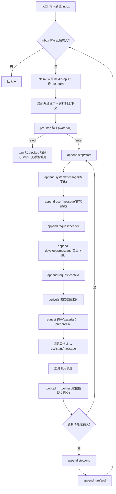

# 运行时主链路（runtime-spine）

> 状态:设计产物 · 2026-10-12 · 作者:本人
> 依据:[ADR-0002](decisions/0002-design-alignment-and-native-builtins.md)(设计对齐)、[ADR-0003](decisions/0003-usable-harness-and-t3-scope.md)(全做 + Python + 先内核)
> 证据:所有上游依据以 `sources/deepseek-harness/` 为根;拆解结论引用 [dsh-study kb](../../../sources/dsh-study/kb/00-index.md) 章节号
> **本文是主链路图,也是唯一需要盯住的那张图。** 四份机制契约(M1–M4)都以它为前提。

---

## 0. 一句话结论

一个 agent 轮次的本质是**一条对日志的追加序列**。除日志之外的任何状态(相位、上下文、token 计数、工具调度进度)都是**可从日志重建的派生量**;凡是不能从日志重建的状态,都是 bug 而不是优化。

因此主链路的正确性判据只有一条:**给定日志,能重建出当时发给模型的每一个字节,以及当时为什么这么发。**

---

## 1. 分层与归属

我们的实现叫 `arm`(agent-runtime-min)。分层**按变化速率**切,不按功能切:

```text
src/arm/
  kernel/     插件容器 + 事件分发 + 可逆注册     ← 变化最慢
  session/    M1:日志、surface、derive            ← 契约层,变了要迁移数据
  llm/        模型接缝:prepareCall / stream
  prompt/     系统提示装配(有序段 + 工具 schema)
  tools/      M3:注册表 + 七段流水线
  context/    M2:计量、压缩、裁剪、落盘
  eval/       M4:回归集、trace 评估、judge
  cli/        唯一入口
```

**依赖方向**(硬规则):

```text
cli → kernel → session → (llm, prompt, tools, context, eval)
                    ↑
        所有能力包只依赖 session 的契约,不依赖彼此的具体实现
```

**为什么这样切**:`session` 是唯一需要「读到旧数据」的层,它的改动成本随已产出的日志量线性增长;其余各层可以随时重写。把变化最慢的东西放在依赖图的下游,是让上层改动不波及数据契约的唯一办法。

---

## 2. 主链路:一个 turn 的完整事件序



**读图要点**(每一条都是不变量,见 §4):

1. **`turn/start` 先于 claim**。所以「输入被拒绝」和「空轮次」在日志里都是**结构完整的轮次**(有 start、无 step、有 end),不需要特殊编码。
2. **`step/start` 在 pre-step 之后、request 之前**。被 reject 的批次不产生 step。
3. **工具结果按模型序提交**,但工具主体可以并发。两者是不同的约束,不能混。
4. **每个出口都写 `turn/end`**。它是轮次内最后一条持久事件。
5. **`derive()` 是请求体的唯一来源**。不存在「另存一份 messages 数组」的路径。

---

## 3. 事件词汇(我们的子集)

上游有 59 个持久事件。**我们第一版只取 19 个**,按 scope 分组:

| scope | 事件 | 为什么必须有 |
|---|---|---|
| `session` | `start`, `end-seed` | 日志头与世代种子 |
| `turn` | `start`, `end` | 轮次边界;end 携带终止原因 |
| `step` | `start`, `end` | 步骤边界 |
| `request` | `header`, `context` | 「模型可见即已记录」的两条腿 |
| `system` | `message` | 系统提示快照 |
| `user` | `message` | 用户输入;也承载 replace 操作 |
| `developer` | `message` | 工具增删的增量告知 |
| `assistant` | `message`, `attempt` | 模型输出;无内容的中断落 attempt |
| `tool` | `call`, `result` | 工具配对 |
| `compaction` | `start`, `summary`, `prune`, `end` | 压缩事务的四条 |
| `error` | `turn-failure` | 轮次失败原因(与 turn/end 分离) |

**被我们砍掉的**(不是不重要,是第一版不需要):

- `team/*`、`subagent/*`(T3 阶段再加,但**事件命名要预留**:`subagent/*` 前缀现在就占位,避免以后改名导致迁移)
- `feedback/*`、`hook/*`、`telemetry/*`
- `image/offload`(图片先按普通内容处理)
- `session-log-*`(上游的遥测投递,与日志契约无关)

**为什么砍**:上游的 59 个事件里,大多数服务于它自己的产品面。事件名词是**唯一改一次就要迁移数据**的东西(上游为此付出 4 个格式代际),所以第一版必须小,但**命名必须留好扩展位**。

---

## 4. 不变量(重写时必须遵守)

编号 `S.x` 为主链路级;各机制另有自己的不变量(`M1.x` / `M2.x` / `M3.x` / `M4.x`)。

| # | 不变量 | 违反了会怎样 |
|---|---|---|
| S1 | **单一相位变量**:`phase ∈ {idle, running, maintenance}`,`status` 由它派生,不独立存储 | 两个状态源必然发散;唤醒输入丢失或打断维护任务 |
| S2 | **驱动器是 `while (await turn())`**:turn 返回布尔表示「还有待处理输入」 | 递归或事件驱动会丢失「同一轮内的连续步骤」语义 |
| S3 | **inbox 是日志的投影,不是内存队列** | 冷读、重启、UI 与服务会看到不同状态 |
| S4 | **claim 即删除**:被认领的输入不再出现;被 reject 的不恢复、不重发 | 拒绝后重发会造成同一输入被处理两次 |
| S5 | **`turn/start` 先于 claim** | blocked 轮次无法表达 |
| S6 | **`turn/end` 是轮次内最后一条持久事件**,每个出口都写 | 日志出现无结尾的轮次,恢复时无法判定 |
| S7 | **`step/start` 在 pre-step 之后** | reject 分支会留下空 step |
| S8 | **工具结果按模型序提交**,且 `tool/result` 必须引用其 `tool/call` 的 seq | 悬空 tool_call 会让下一次请求被模型拒绝 |
| S9 | **取消后未派发的调用必须有合成结果** | 同上 |
| S10 | **请求体只能来自 `derive()`**;`derive()` 的输出深度冻结 | 请求与日志漂移,「可重建」失效 |
| S11 | **waterfall 钩子必须调用 `next()`**,否则链被短路 | 静默吞掉后续监听器,且无测试会红 |
| S12 | **取消只有一条路径**,`cause` 类型化,持久化只存可 JSON 字段 | 多路径取消会产生无法复现的中间态 |
| S13 | **创建/恢复是受回滚保护的事务**:资源先注册 disposer 再发布 | 失败后留下半注册的 agent |
| S14 | **失败即结果**:模型错误、工具错误、参数错误都不抛出到循环,而是转成可记录的终态 | 一次工具失败会炸掉整个轮次 |

---

## 5. 失败分支矩阵

| 场景 | 结果 | 日志痕迹 |
|---|---|---|
| pre-step 返回 reject | turn 以 `blocked` 收尾,无 step、无模型调用 | `turn/start` + `turn/end{blocked}` |
| 首步空批次 | turn 以 `completed` 收尾,返回 false | `turn/start` + `turn/end{completed}` |
| 模型错误且不重试 | turn 以 `error` 收尾 | `error/turn-failure` + `turn/end{error}` |
| 模型错误且重试 | 同一 step 重跑请求,**不重复准入** | 不新增 `user/message` |
| 流中断但有内容 | 落 `assistant/message{interrupted:true}` | 保留已产出内容 |
| 流中断且无内容 | 落 `assistant/attempt` | 不产生空 assistant 消息 |
| 工具参数非法 | `tool/result{isError:true}`,**step 继续** | 配对完整 |
| 未知工具 | 同上,且仍走完 pre-execute | 配对完整 |
| 权限拒绝 | 同上 | 配对完整 |
| 工具主体抛错 | 同上 | 配对完整 |
| 取消 | turn 以 `aborted` 收尾 | 未派发调用补合成结果 |
| 拆除 | `cancel{disposed}` → 等空闲 → 释放 | 同取消 |

**关键**:上表**没有一行**是「抛出到调用方」。唯一的例外是**调度器自身失败**(写日志失败、进程被杀),那属于基础设施故障,不是业务失败。

---

## 6. 我们的选择 vs 上游的选择

按 [ADR-0002](decisions/0002-design-alignment-and-native-builtins.md) §5,契约正文必须**抽掉上游名字后独立成立**。因此本节只列**刻意的差异**,依据放 §7。

| 维度 | 上游 | 我们 | 为什么不同 |
|---|---|---|---|
| 语言 | TypeScript | **Python** | 本人主力栈;与上游生态脱钩,clean-room 更彻底 |
| 事件数 | 59 | **19**(预留扩展位) | 第一版不需要上游的产品面事件;事件名词改一次就要迁移 |
| 格式版本 | 4 个代际 + 相邻迁移链 | **1 个版本,无迁移链** | 我们没有已发布数据。迁移链是「有用户之后」才需要的成本,见 [41 章](../../../sources/dsh-study/kb/chapters/41-porting-playbook.md) §4.3 |
| 持久化容器 | zstd 分帧 | **裸 JSONL** | 可读性优先;调试时能直接 `cat` |
| 装配模型 | profile/bundle/patch 三层 | **单配置文件 + 插件列表** | 第一版不做三层叠加;上游自己的最小 profile 也是单文件 |
| 相位 | 含 `maintenance` 与 `status` 解耦 | **同构保留** | 这条是本质(见 S1),不是细节 |
| 工具并发 | 有界滚动池 | **同构保留** | 见 M3 |

---

## 7. 依据(上游证据索引)

| 结论 | 章节 |
|---|---|
| turn/step 状态机、事件落盘序、投递语义、取消 | [图册 01](../../../sources/dsh-study/kb/diagrams/01-agent-loop-state-machine.md) |
| 循环的函数级不变量 I1–I22、失败矩阵 | [60-agent-loop-deep](../../../sources/dsh-study/kb/chapters/60-agent-loop-deep.md) §5 |
| 「本质 vs 细节」的划分 | [60](../../../sources/dsh-study/kb/chapters/60-agent-loop-deep.md) §6 |
| 最小内核的组成与「哪些不要照搬」 | [41-porting-playbook](../../../sources/dsh-study/kb/chapters/41-porting-playbook.md) §2.1、§4.3 |
| 事件三域与分发模式 | [40-design-philosophy](../../../sources/dsh-study/kb/chapters/40-design-philosophy.md) §2.2 |
| 持久事件全表(59 个) | [data/session-events](../../../sources/dsh-study/kb/data/session-events.md) |

---

## 8. 未解决 / 待验证

> **2026-10-15 更新**:第 1、2、3 项**已实测**,用 `make claims` 复现。结论见下。

1. ~~**【未验证】19 个事件的子集是否够跑通一次真实任务。**~~ **已测**:每轮真实任务的**每个阶段都有对应事件类型**(session/start、system/message、user/message、turn/start、step/start、request/header、assistant/message、tool/call、tool/result、step/end、turn/end 共 11 个阶段)。词汇表实际 **28 个**类型。担心的高频事件 `request/context` 是**每步一个**——即**与步数成正比,不是与日志长度成正比**,所以日志是线性增长而非二次。**一次真实 turn = 约 20 个事件**(实测)。
2. ~~**【未验证】裸 JSONL 的写入吞吐是否够用。**~~ **已测**:**实时路径 0.090 ms/事件**——这是会话真实的形状,因为 CLI 传了 `already_contiguous=True`。10 万事件 = 56 MiB,单批追加 1.7 s;fsync 屏障 0.03 ms。**恢复是线性的**(实测 1 万/2.5 万/5 万/10 万四档确认,0.022 ms/事件),所以 **2,000 事件的会话(约 100 轮)打开耗时 43 ms**。
   - 顺带量到一条**代价的准确数字**:不传 `already_contiguous` 时每次追加**重读整个文件**,4.657 ms/事件——**这正是那个标志存在的理由**,现在是个已知常数而不是一句断言。
3. ~~**【推断】「单配置文件」是否会在 T3 阶段被迫升级为多层。**~~ **已测**:四个文件各管一件事(`config.json` 插件 / `mcp.json` / `hooks.json` / `schedule.json`),**没有任何覆盖关系**,总行数远低于 300 的触发线。T3 的 20+ 能力没有迫使它分层。
4. **【未验证】Python 的 `asyncio` 取消语义能否直接承载 S12。** 上游用 `AbortController`;Python 用 `asyncio.CancelledError` + 自定义 cause。两者的传播与「不抛弃已启动的协程」是否等价,需在 M3 实现时验证。
